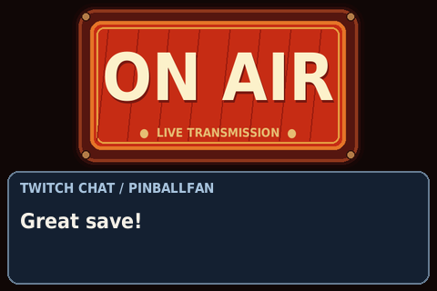
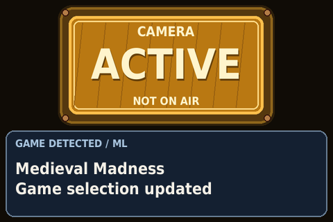
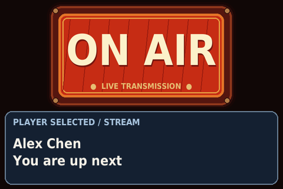
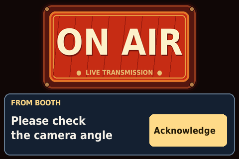

# Pin rig display engineering plan

Proposed design · 27 October 2026 (human edited 10/30)

Build a persistent camera-status sign with a small event area. A person walking
up must immediately understand whether this rig is on air, being used locally,
or inactive. Chat and booth messages must never obscure that answer.

This is a plan, not implemented behavior. The existing project provides a
480 × 320 landscape ST7796 renderer, RGB565 SPI output, an HTTP page API, and
an ON AIR animation. It currently restores the last page after restart. 

Hardware: currently developing 
## 1. Display contract

The camera-state graphic fills the 480 × 320 screen by default. Use the new
`assets/camera-active.png` and `assets/inactive.png` artwork and the existing
ON AIR renderer as the visual reference. Preserve their sign housing, typography,
and aspect ratio. Remove the rig identity and USB connection footer entirely;
identity and connection details remain available through touch and the API.
Game/player context is stored but does not occupy space while idle.

When a temporary card appears, animate the state graphic into the top 188 pixels
and expand the card into the bottom 132 pixels. Scale the sign proportionally
inside that region without cropping its words or hardware-style housing. When
the card leaves, reverse the transition: the card disappears and the state sign
returns to the full screen. The mockups below use illustrative event data. The
three normal state examples retain subtle animation in their housing.

| State | Meaning | Appearance and subtle motion |
| --- | --- | --- |
| ON AIR | This rig contributes to at least one active stream output. | Existing red ON AIR sign; housing breathes over four seconds, with steady lettering. |
| CAMERA ACTIVE | No confirmed live contribution; at least one local consumer is active. | New amber CAMERA ACTIVE artwork with NOT ON AIR; a gentle housing highlight cycles over three seconds. |
| CAMERA INACTIVE | All required sources are fresh and explicitly report no live contribution and no local consumer. | New slate INACTIVE artwork; housing breathes gently over six seconds. |
| STATUS UNKNOWN | Required evidence is missing, stale, or disconnected and cannot establish a definitive state. | Matching neutral sign with UNKNOWN and CHECK STREAM PC. Static diagnostic card shows the last confirmed status and age. |

### On air


### Camera active


### Camera inactive


### Status unknown


Use explicit words and color together; retain the lettering in the repository artwork. Do not label inactivity as privacy:
this sign only reports monitored consumers. Do not imply recording merely
because a preview is open. Keep NOT ON AIR on the active sign. Detailed use reasons such as local recording
or OBS preview appear in touch details rather than a permanent subtitle.
Keep status text at least 40 pixels, body text around 22 pixels, and identifiers
at least 14 pixels. Wrap or ellipsize card text; do not shrink sign lettering below the minimum
readable size when composing the compact view.
No scrolling marquees, full-screen chat, flashing transitions, or video preview.

## 2. Authority and state resolution

The PC bridge owns source interpretation. Configure a stable `rig_id` and map
OBS sources or scene compositions to `rig_1`, `rig_2`, or both. The Mega Pinball
composition includes both only when both feeds actually contribute. A selected
scene alone does not establish that a stream output is running.

For each destination, evaluate whether an output is active and this rig is in
its actual program composition. Account for nested scenes, source visibility,
transitions, and alternate outputs. OBS preview counts as local use, not live
program. A rig remains live during a transition while its feed contributes.
Resolve live status per rig: a broadcast using rig 2 does not make rig 1 live.
Treat an output connection failure as unknown delivery until the adapter can
establish output state; the sign reports PC output state, not verified viewer
receipt at Twitch or another destination.

Videonode provides per-rig consumer activity and reason when available. Aggregate
local use with OR across OBS preview, local recording, and videonode consumers.
A fresh positive from either local source wins over a negative from the other.
OBS recording counts only if that recording actually includes this rig. Merely
having OBS running does not establish local use. Configure the expected sources;
an intentionally unused source does not block inactivity.

Apply this rule on the Pi to the normalized, freshness-qualified facts:

```text
if any fresh output confirms this rig is live:      ON_AIR
elif any required live source is unknown:          STATUS_UNKNOWN
elif any fresh source confirms local use:          CAMERA_ACTIVE
elif any required local source is unknown:         STATUS_UNKNOWN
else:                                             CAMERA_INACTIVE
```

Freshness applies separately to each output and consumer source. A healthy USB
heartbeat cannot renew evidence from a disconnected OBS adapter. Unknown wins
over a lower state when live contribution cannot be ruled out; show confirmed
local use as supporting context in that case. Never treat absent fields as false.

Enter ON AIR or ACTIVE on the next display cycle. Require a continuous one-second
fresh negative before lowering ON AIR to ACTIVE or INACTIVE, or ACTIVE to
INACTIVE, to avoid transient flicker. Unknown evidence takes effect immediately;
show the last confirmed state with its age, not as current truth. Start and
restart in UNKNOWN until a complete fresh snapshot arrives. Persist identity
and optional game/player context, never camera status as authoritative truth.

## 3. Event presentation

The camera state always wins, including during booth messages. With no card,
the sign fills the screen. A timed card opens only for its useful lifetime;
then the sign expands again. Game and player state updates apply immediately
even when their announcement is waiting; the latest values are available in
touch details without a permanent context panel.

Use a 500 ms smooth ease-in/ease-out transition in each direction, initially
four layout steps at the current eight frames per second. The sign moves and
scales into its compact region while the card reveals upward beneath it;
neither overlaps the other. Start the card's reading duration after opening
finishes, but keep acceptance-based expiry unchanged. Touch targets are active
only once the opening finishes and are disabled during closing. On expiry,
dismissal, or acknowledgment, collapse the card and restore the full-screen
sign. Consecutive queued cards may replace content while the layout remains
compact, avoiding repeated expansion between messages.

A new event during closing retargets the animation from its current geometry.
A camera-state change replaces the sign on the next display cycle even during
a transition; never finish showing an obsolete state first. UNKNOWN cancels
optional transitions and immediately shows its sign plus diagnostic card. Its
card remains until source evidence recovers, then collapses to the current
full-screen state. Pause subtle housing motion during layout transitions.

### Message expansion and return


| Event | Card policy | Lifetime and overload behavior |
| --- | --- | --- |
| Booth message | Highest card priority; interrupts any lower card. Label FROM BOOTH with an Acknowledge button. | Display for up to 15 seconds or until acknowledged; expire 30 seconds after acceptance. Maximum three pending; reject overflow explicitly. |
| Current player updated | Second priority; show name and selection origin. | Five seconds; expire after 15 seconds; replace pending player announcement with newest. |
| Current game detected or set | Third priority; show title and ML or manual origin. | Five seconds; expire after 15 seconds; replace pending game announcement with newest. |
| Twitch chat | Lowest priority; show sender and plain text. | Six seconds; expire after 15 seconds; retain newest three pending, drop oldest on overflow. |

Lifetime starts on acceptance using the Pi's monotonic clock; the host must not
submit chat or notices already expired upstream. Drop expired cards before
selection. Equal-priority cards use acceptance order. Interrupted cards are
discarded rather than replayed; explicit booth cancellation removes its card.
Unknown status reserves the expanded card area for diagnostics, suppresses chat, and
rejects booth cards as temporarily unavailable so the PC can notify the operator.
Game/player state can still update, but do not queue their announcements there.

Cap booth/chat text at 160 characters, names at 40, and game titles at 80.
Render at most three card lines; booth cards use two lines beside the touch
button. Ellipsize overflow with a visible marker.
Return `truncated: true` when accepted text will be shortened; the PC retains
the complete message. Booth receipt means accepted/displayed; only an explicit
touch produces a human acknowledgment, and it does not prove the full text was
read or the requested action completed. Status changes immediately interrupt card drawing but retain an
unexpired card unless entering UNKNOWN.

### Twitch chat



### Current game updated



### Current player updated



### Message from the booth



The PC handles Twitch connectivity, moderation, event routing, game inference,
and player selection. Send only moderated chat intended for this rig. Manual
game selection overrides ML until explicitly cleared or replaced manually;
unstable ML detections must be stabilized on the PC before publishing. Use the
same explicit precedence for manual versus automatic player selection. Empty
game/player values clear context; unknown context displays GAME UNKNOWN or
PLAYER UNSET rather than invented defaults.

## 4. Touch interactions

Use touch to acknowledge and inspect. Camera status remains visible and cannot
be changed by touch. No camera controls, game/player editing, gestures, or
long-press shortcuts in the first release.

| Touch target | Behavior |
| --- | --- |
| Booth Acknowledge button | Save an acknowledgment tied to this message and rig, dismiss the card, and briefly show ACKNOWLEDGED — DELIVERY PENDING. Show feedback for two seconds, then restore the full-screen sign; pending delivery remains visible in touch details and API status until PC confirmation. |
| Chat or game/player announcement | Dismiss early, expose `dismissed` in event status, and expand the state sign to fill the screen. A booth card is dismissible only through its explicit button or PC cancellation. |
| Idle full-screen state sign | Tap to open a temporary details card using the same expansion animation. Show full game/player names, selection origin, rig identity, source/connection health, and pending acknowledgment delivery. Wrap into up to three pages with Next and Close buttons; Close or ten seconds without touch restores the full-screen sign. |
| Compact state sign or UNKNOWN diagnostics | No action. Only the visible card controls accept touch while a card is open. |

Booth cards preempt details; other notices wait for details to close and retain
their normal expiry. Camera-state changes remain immediate. Entering UNKNOWN
closes details, removes cards as already specified, and cancels any touch in
progress. Details never pause source freshness or card expiry.

Provide explicit Next/Close targets and a booth button at least 140 × 56 pixels;
all card controls must be at least 48 × 48 pixels and stay inside the expanded
card area. Touching the idle sign opens details only after a fresh press and release.
Show a pressed appearance immediately. Activate only on release within the
same target after a new press that began there. Bind the gesture to the visible
card ID and layout revision: card replacement, expiry, cancellation, or a layout
change invalidates it. Touch held before a message appears cannot acknowledge
it. Ignore drags, additional contacts, repeated releases, and a held touch;
require release before accepting another gesture. Use driver debouncing plus
an injected-clock gesture recognizer; tune movement tolerance on the hardware.

Save booth acknowledgments atomically before reporting local success. Use a
bounded durable outbox of 100 records; replay across USB reconnection, new
bridge sessions, and Pi restart until the PC explicitly confirms storage.
Deduplicate on the PC by interaction ID. If storage fails or the outbox is full,
retain the message, disable acknowledgment with a visible reason, and report
the fault; never claim success. Do not silently expire unconfirmed records.
Timeout, cancellation, dismissal, and successful SPI output never synthesize
an acknowledgment. The booth UI distinguishes displayed, expired without
acknowledgment, and acknowledged at the rig; no individual identity is implied.

Verify the exact panel's touch controller, wiring, interrupt line, and available
Linux input driver before implementation; ST7796 display support alone does not
establish touch support. Put input behind a small adapter that emits calibrated
press/move/release events with monotonic times. Calibrate and rotate coordinates
to the 480 × 320 landscape image; reject invalid coordinates. Serialize shared
SPI access if the touch hardware uses that bus. Document any added GPIO or
electrical connections before changing wiring. A missing or failed touch device
must leave camera-status rendering operational and expose `touch_unavailable`
to the PC, which can offer an operator-side acknowledgment path.

## 5. USB boundary and ownership

```text
OBS outputs and scene graph ─┐
Videonode consumers ─────────┤
Twitch and booth ────────────┼─> PC bridge ── USB ──> Pi event API
Game and player services ───┘                        │
                                      validation → reducer → card scheduler
                                                           │
                                      PC <── status/acks   renderer → SPI
                                                           ↑
                                             touch input → gestures
```

Proposed transport: USB gadget Ethernet with a private point-to-point subnet,
carrying HTTP/JSON. This reuses the existing standard-library HTTP stack and
provides bidirectional requests without a serial framing layer. The PC posts
events and snapshots; the Pi produces response acknowledgments and exposes
status for PC polling. No inbound PC listener, cloud dependency, or direct
Twitch/OBS integration runs on the Pi.

Before adopting it, verify the deployed Pi OS, stream PC OS, USB gadget driver
support, stable interface identity, and a data-capable connection to the Pi's
USB data port. Document power ownership and wiring before deployment, including
any simultaneous power connections. Do not assume two power feeds are safe.
If gadget Ethernet is unsuitable, use USB serial behind the same event
interface and specify framing/recovery separately; do not ship two transports
in the first release.

Bind the event API to the USB interface, disable routing from it, and authenticate
the paired bridge with a provisioned token kept outside version control. Do not
carry forward the current unauthenticated LAN-wide write surface. Keep optional
development HTTP on loopback. Preserve BCM numbering and existing SPI wiring;
make no backlight or pin changes as part of this plan.

## 6. Proposed API and delivery contract

These routes and schemas are new proposals. The current `PUT /api/display`
accepts page commands and cannot enforce the proposed state model.

| Endpoint | Contract |
| --- | --- |
| `PUT /api/v1/session` | Authenticated bridge opens a new session; Pi returns a fresh non-secret session ID. Replaces the prior session, clears transient cards, and requires a full snapshot. |
| `PUT /api/v1/snapshot` | Atomically replaces current facts and game/player context for this rig; sent on connect, reconnect, adapter recovery, and every second. |
| `POST /api/v1/events` | Applies one typed event: `camera.facts`, `game.updated`, `player.updated`, `chat.message`, `booth.message`, or `booth.cancel`. |
| `GET /api/v1/status` | Returns revision, resolved camera state, evidence age/quality, context, current card ID, last displayed revision, faults, and queue/drop counts. |
| `GET /api/v1/interactions` | Returns up to 100 unconfirmed durable booth acknowledgments, oldest first. PC polls every second while connected. |
| `POST /api/v1/interactions/ack` | PC confirms interaction IDs only after durable storage; Pi removes those outbox records atomically. Repeated confirmation is harmless. |
| `GET /healthz` | Separates process, transport, source freshness, and display-write health. Required stale sources or failed display writes make readiness unhealthy. |

Use one serialized PC sender per rig with a strictly increasing sequence across
snapshots and events within a session. Reject previous-session traffic. Retries
keep the same sequence and event ID; acknowledge exact duplicates without
reapplying or extending card lifetimes. Reject changed content under a reused
sequence or ID. On a sequence gap, stop applying deltas and request a complete
snapshot; a newer full snapshot may bridge the gap and reset the baseline.
Discard pre-reconnect transient notices. On any successful new session,
including after a Pi restart, rebuild current truth from the PC.

Example event envelope:

```json
{
  "version": 1,
  "session_id": "pi-issued-session-id",
  "seq": 42,
  "event_id": "booth-105",
  "rig_id": "rig_1",
  "type": "booth.message",
  "payload": {"text": "Please check camera angle"}
}
```

A snapshot carries `version`, `session_id`, `seq`, `rig_id`, `facts`, `game`, and
`player`. Each configured fact has a source ID, tri-state value (`true`, `false`,
or `null`), a reason, and source observation age in milliseconds. Output facts
mean this rig contributes to an active output; consumer facts mean local use.
The Pi adds elapsed time since receipt to source observation age. Freshness
must come from actual upstream observation or verified source health, never
from retransmitting cached facts. Define each adapter's health check during
implementation. Context includes origin, revision, and manual-override state.
All schemas reject unknown required semantics and unsupported versions.

Start with a one-second snapshot/heartbeat interval and a three-second evidence
timeout. Use monotonic local time for deadlines; wall-clock timestamps are
diagnostic only. Reconnection uses bounded backoff up to five seconds. These
are configurable initial values, to be tuned on target hardware.

Bound request bodies to 8 KiB, reject wrong rig IDs and invalid types/lengths,
strip nonprinting control characters, and render plain text without executing
markup or loading remote images. Limit ingress to 20 requests/second with a
40-request burst; throttle optional chat first and retain snapshot capacity.
Keep at most ten seconds of deduplication responses; older sequences remain
rejected by the session high-water mark. Bound all queues and caches.

Return accepted revision and event ID after validation and state application.
Expose `accepted`, `displayed`, `expired`, `dropped`, `cancelled`, or `failed`
for transient events through status polling, retaining the latest 100 terminal
results for 60 seconds. A successful SPI write establishes `displayed`; it does
not prove the physical panel is visible. Use 4xx for validation/authentication,
409 for resynchronization, 429 for capacity, and 503 for unavailable display or
presentation. A display failure must not silently discard authoritative facts;
status reports the accepted revision and failed presentation separately. Add
`dismissed` and `acknowledged` terminal results for touch actions; transport
confirmation of an interaction remains distinct from human acknowledgment.

Pi-produced interactions use a globally unique `interaction_id`, `rig_id`,
`type: "booth.acknowledged"`, original `message_id` and `message_session_id`,
and `occurred_at` (UTC or null when the clock is unset). The original session
identifies the message even after reconnect; it is not an authorization token.
Poll and confirm under the current authenticated session. These records use a
separate delivery namespace from PC event sequences. Preserve the bridge's
message lookup and stored acknowledgments across its restart. Store duplicate
interaction IDs idempotently and never interpret a late acknowledgment as a
response to a newer message. Interaction delivery and any pending local feedback
survive card expiry; source state always retains display priority.

## 7. Pi implementation and resource budget

Extend the current Python 3.11 application incrementally. Use small modules for
validated event models, USB-facing API, a pure state reducer, monotonic freshness
policy, card scheduling, touch gestures, durable interaction outbox, and Pillow
layout. Retain the narrow display transport
and RGB565 encoder. One application worker owns state; one serialized writer
owns all SPI access, including animation. Request threads enqueue bounded work;
they never write hardware directly. Status and source changes outrank optional
card work. Use locks or immutable snapshots for status reads.

The touch adapter queues input to that same worker; it never mutates application
state or writes the display directly. Coalesce movement events and preserve
press/release ordering; input overflow cancels the active gesture and waits for
release. Close input resources on shutdown. Target pressed feedback within
100 ms, without delaying camera-state updates or blocking on USB delivery.

Start with the current eight animation frames per second, updating only changed
regions. Keep text static and animate small indicators or outlines. Cache fonts
and static layout; do not pre-render every full-screen card at every phase. One
480 × 320 RGB565 frame is 307,200 bytes; eight full frames per second require
about 19.7 Mbit/s before overhead, nearly the current 20 MHz SPI setting.
Partial writes are therefore a requirement, not an assumed speed improvement.
Keep animation caches below 4 MiB and measure total process memory on the Pi.

Target a visible status change within 500 ms of accepted facts under sustained
chat traffic, excluding deliberate downward debounce. Skip late animation
frames rather than accumulate them. Layout transitions change most of the
screen: allow bounded full-frame writes at no more than eight frames per second,
pre-render only the small transition sequence, and measure actual transfer time.
If the deadline cannot be met, use fewer steps or an immediate layout change;
never increase SPI speed automatically or delay a camera-state update. Derive
layout geometry from an injected clock rather than a queued list of deadlines. If rendering is overloaded, stop motion
first and preserve the static status. Inject clock, delays, and transport for
deterministic tests. Release SPI/GPIO on all shutdown and failure paths. Report
write failures to the PC and logs; retry initialization with bounded backoff,
then redraw current truth. A frozen or unpowered panel cannot signal its own
failure, so the PC must surface missing health or stopped display progress.

## 8. Delivery and acceptance

1. Confirm source-to-rig mapping, touch hardware, and USB/power setup. Record actual OBS and
   videonode observation contracts, required sources, and supported outputs.
2. Implement reducer, freshness, restart semantics, and deterministic tests;
   then build the bridge and versioned USB API with reconnect coverage.
3. Implement status layouts, bounded cards, touch interactions and outbox,
   partial animations, and display
   health. Replace arbitrary page selection in production; keep developer
   preview tooling unable to override production status.
4. Run the full unit suite, then separate Pi integration and walk-up checks.
   Keep deployment and wiring instructions current with the accepted design.

Acceptance tests must cover both rigs independently and together; streaming
stopped with a live-looking scene; preview-only use; recording-only use;
videonode-only consumers; contradictory/stale sources; transitions; and multiple
outputs with one remaining live. Verify startup, USB loss, OBS loss while USB
stays healthy, PC/Pi restart, duplicate/out-of-order events, snapshot recovery,
booth cancellation, manual override precedence, queue saturation, and SPI failure.
Use fake clocks and transports for unit tests, with no sleeps or hardware.

Layout tests cover full-screen idle geometry, footer absence, preserved artwork
aspect ratio, compact-label legibility, opening/closing geometry and deadlines,
card replacement without layout churn, retargeting during closing, immediate
state changes during motion, expiry before opening finishes, and UNKNOWN
preemption. Verify the sign fills the screen again after every dismissal path.

Touch tests cover rotated/calibrated coordinates, target boundaries, touch held
before card arrival, press/release across different cards, drag cancellation,
duplicate releases, expiry/cancellation during press, UNKNOWN transitions, and
touch bursts. Verify details paging and preemption, single acknowledgment per
message, outbox write failure/full capacity, PC storage before confirmation,
lost confirmation responses, replay across PC/Pi restart, late delivery, and
continued status display when touch fails. On hardware, check every screen
corner, accidental brushes, button size, shared-bus contention, and feedback latency.

On the Pi Zero 2 W, verify the latency target, partial-write behavior, memory,
CPU load, reconnect behavior, and an eight-hour soak under chat bursts. At the
installed distance and venue lighting, observers must distinguish all three
camera states and UNKNOWN without relying on color. Confirm animations are
subtle and status remains legible with every card. Product decisions still to
confirm: normal viewing distance, final typography, whether long booth notices
need an explicit continuation workflow, and the operator UI for source faults.
