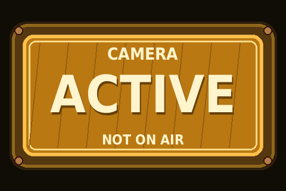
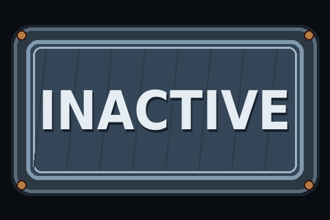
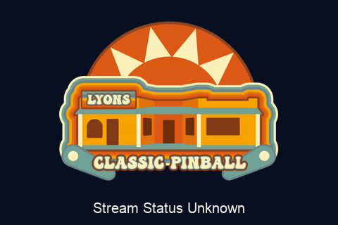

# Display device plan

Implementation tracking: [current status](implementation-status.md) and
[implemented protocol](protocol.md). The roadmap below includes deferred hardware
and external-source work.

Updated 30 October 2026. Proposed behavior unless identified as current in the
[README](../README.md).

## Development path

1. **Now: Pi 4B directly connected over SPI.** Validate signs, messages,
   transitions, readability, and overall feel on the real display. Use explicit
   test commands; no OBS integration is needed to evaluate the UI.
2. **When the Pi Zero 2 W arrives:** mount it behind the display and move SPI
   ownership to it. Confirm wiring and power before soldering or connecting.
3. **Final arrangement:** the 4B runs the [HTTP host service](host-plan.md),
   receives events from others, and sends commands to the Zero 2 W over USB
   serial. The Zero 2 W renders those commands on the display.

Keep the direct-SPI development path aligned with the USB command contract:
use the same request models, validation, responses, and presentation logic.
Only the delivery adapter changes from local calls to USB serial. Do not build
a second renderer or a separate set of development-only command semantics.

## Device responsibility

The device knows how to show a requested state sign, present generic messages,
and report health and interactions. It does not interpret OBS scenes, decide
whether a stream is live, track game/player facts, or connect to event services.
Those policies belong in the [event producer plan](event-producer-plan.md).

Keep one small device application with clear boundaries for command validation,
presentation state and scheduling, rendering, and hardware I/O. USB serial and
optional Wi-Fi HTTP are thin adapters to the same command handler. Serialize
updates and SPI writes; both interfaces can operate at once, with the latest
accepted state command winning. No transport handler writes hardware directly.

## State signs and layout

Use the existing ON AIR renderer and repository artwork as visual references.
Preserve the sign housing, lettering, and aspect ratio. State is an explicit
instruction from the host, rather than a conclusion drawn on the device.

| Requested state | Presentation |
| --- | --- |
| ON AIR | Red sign; housing breathes over four seconds, lettering stays steady. |
| CAMERA ACTIVE | Amber CAMERA ACTIVE artwork with NOT ON AIR; gentle housing highlight over three seconds. |
| CAMERA INACTIVE | Slate INACTIVE artwork; gentle housing motion over six seconds. |
| STATUS UNKNOWN | Static LCP logo with small centered subtext reading “Stream Status Unknown”. Fills the screen without a message; shrinks above a message card when present. |

The state sign fills the 480 × 320 screen when there is no message. UNKNOWN
instead shows the LCP logo from `assets/logo.png`, preserving its transparency
and aspect ratio on the dark background, with a 20-pixel caption beneath it.
Bundle the logo with the device package so installed services can render it
without a source checkout. Keep detailed failure reasons in status responses
and logs. Do not display a large UNKNOWN sign or a separate diagnostic card.
A temporary
message compacts the sign into the top 188 pixels and opens a card in the bottom
132 pixels. Scale proportionally without cropping. State remains legible and
updates immediately, including during transitions or message presentation.

Start with a 500 ms ease-in/ease-out transition, then tune on the display.
Pause subtle housing animation during layout changes. On expiry, dismissal, or
acknowledgment, restore the full-screen sign unless another message is ready.
Retarget an interrupted transition from its current geometry. Prefer immediate
layout changes if animation interferes with timely state updates.

Use words as well as color. Target normal sign lettering of at least 40 pixels and
body text around 22 pixels; validate compact layouts at the actual viewing
distance. Wrap or visibly ellipsize messages rather than shrinking them to fit.

### Visual references

These mockups illustrate layout and motion; their source-specific labels are
example message content, not separate device event types.

## Generic command contract

Define one versioned command model before adding USB. The following operations
are proposed; the existing page API remains documented in the README.

| Operation | Responsibility |
| --- | --- |
| Set state | Select a supported state sign; return the accepted revision. |
| Show message | Accept title, message text, duration, requires-ack flag, and priority; return a message ID. |
| Cancel message | Remove a message by ID, whether visible or pending. |
| Read status | Report requested/displayed state, message status, queue depth, interactions, and device faults. |
| Confirm interaction | Confirm receipt of an acknowledgment by interaction ID. |

Use UTF-8 newline-delimited JSON for USB requests and responses, with a protocol
version and request ID. Return structured success or error responses correlated
to the request. Bound frames and queues, handle partial reads, and recover at
the next newline after invalid framing. Reject unsupported versions and invalid
fields explicitly. Keep HTTP payloads and results equivalent to serial; HTTP
only supplies routing and status-code mapping.

Separate command receipt, successful rendering, and human acknowledgment.
Retries with the same request ID must not create duplicate messages or extend
their lifetime. Reject reuse of an ID with different content. Define a bounded
retry/deduplication window and reconnect handshake before implementation; the
host must not assume a timeout means a command was never applied.

Start/restart in UNKNOWN until a current state command arrives. In host-managed
operation, use a simple configurable command lease: the host renews its current
state periodically, and the device shows UNKNOWN if renewal stops. This checks
host/device contact only; source freshness is evaluated outside the device.
After reconnect, replace the current state explicitly and do not automatically
replay old messages. The current last-page restoration needs to change for this
planned behavior.

Optional Wi-Fi HTTP uses the same validation, queue, state ownership, and lease
rules. It does not introduce a second source resolver. Configure access for the
intended network; keep secrets and machine-specific configuration out of Git.

## Message scheduling and interaction

- Keep at most three pending messages, plus the visible card. Reject overflow
  explicitly. Higher priorities are selected first; ties use acceptance order.
- A higher-priority arrival may interrupt a lower-priority card. Mark the
  interrupted card as dropped rather than replaying it unexpectedly.
- A timed message's duration begins once its opening transition completes.
  Use an injected monotonic clock. The host filters notices that are already stale.
- A requires-ack message remains until acknowledged or explicitly cancelled;
  do not impose a timed expiry on it. Report acceptance separately from human ack.
- Keep state updates independent of the message queue. UNKNOWN shows the LCP
  logo and small “Stream Status Unknown” caption above any visible message.
  Preserve visible and queued messages and accept new messages, including after
  state-lease expiry. Retain detailed diagnostics in the status API, not on screen.
- Bound text lengths and render plain text only. Specify limits and truncation
  responses in the shared models; do not silently change accepted content.

Touch acknowledgment is a later step, after confirming the actual touch
controller, driver, calibration, and wiring. Until then, report acknowledgment
capability as unavailable and reject requires-ack messages. A remote cancel
must never count as a human acknowledgment.

For touch, bind a fresh press/release to the visible message ID; replacement,
expiry, or layout changes invalidate the gesture. Persist acknowledgments before
reporting success, keep a bounded outbox, and replay until the host confirms
storage. A full or failed outbox must produce a visible fault and retain the
message. Keep the sign operational if touch fails. Defer context/detail pages
and source-specific interaction workflows.

## Implementation and verification

Keep the eventual device installation small: shared command models, presentation
logic, Pillow rendering, SPI/GPIO support, and thin transport/input adapters.
Package the host separately so installing the device does not pull in producer
clients or host-only dependencies. Prefer small modules and explicit data flow;
introduce abstractions only where local and serial delivery actually share a
contract. Preserve Python 3.11 compatibility.

Keep the existing narrow SPI transport and RGB565 encoder. Measure transfer time
and animation load on both Pis; use changed-region writes where useful, skip
late animation frames, and reduce motion before compromising state updates.
Do not automatically raise SPI speed. Release SPI, GPIO, and serial resources
predictably and report rendering failures in status and logs.

Deliver incrementally:

1. Establish the shared command contract and direct-SPI UI scenarios on the 4B.
2. Validate full-screen states, message transitions, and the bounded generic queue.
3. Add USB serial and the separate host service; run the same scenarios through
   local delivery and a fake serial transport before moving hardware.
4. Move to the Zero 2 W, document verified wiring/power, and validate reconnects,
   device/host restarts, optional Wi-Fi HTTP, and sustained operation.
5. Add touch only after hardware support is established.

Use deterministic tests for validation, transport parity, message ordering and
capacity, expiry, cancellation, duplicate requests, malformed/partial frames,
lease loss, startup/reconnect, rendering errors, and shutdown cleanup. Use fake
clocks and transports without real sleeps or attached hardware. Test touch and
outbox failure paths when implemented. Run the full unit suite for each completed
feature; keep physical display, USB, touch, and viewing-distance checks separate.
